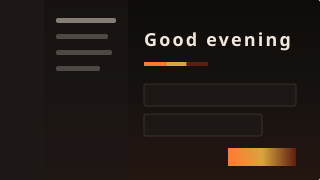
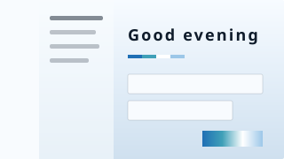
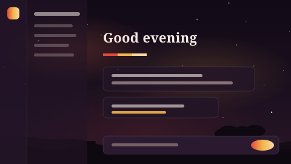
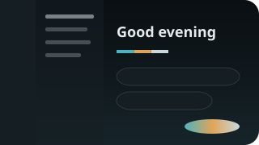
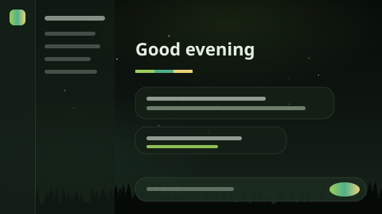
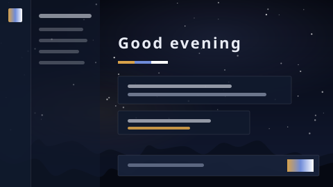
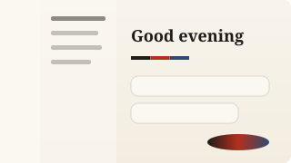
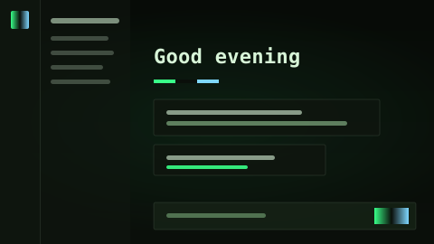
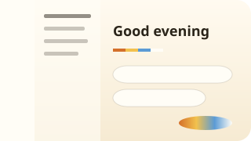
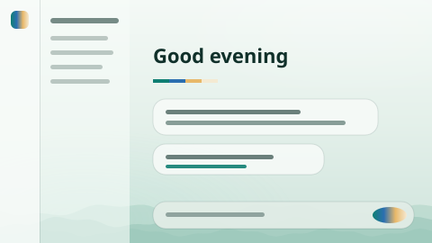

# Shell:B Themes

[](https://github.com/ShellB-App/Shell-B-Themes/actions/workflows/validate.yml) [](LICENSE)

Community themes for [Shell:B](https://github.com/ShellB-App/Shell-B), the local-first AI workspace.
Part of the family with [Shell-B-Screensavers](https://github.com/ShellB-App/Shell-B-Screensavers) and [Shell-B-Agents](https://github.com/ShellB-App/Shell-B-Agents).

A Shell:B theme is **data, not CSS**: a palette, two fonts from a fixed list, a corner shape, a backdrop (sky gradient,
soft glows, stars, a horizon silhouette) and a particle layer drifting behind the app. Shell:B turns that into a
stylesheet itself and checks everything on install: colours must be hex, choices come from fixed lists, and text is
nudged until it meets WCAG AA on its background. A theme file can change how Shell:B looks, and nothing else.

## Install one

In Shell:B open **Settings → Appearance**. Under *Community themes* you see this repository's catalogue, with a tile per
theme. **Install** adds it to your own themes (the ones Shell:B designs in chat live there too) and applies it. Shell:B
fetches this repository as a tarball at a pinned commit and reads `index.json`, so browsing works offline once fetched.

You can also paste a `theme.json` into a chat and ask Shell:B to apply it: the `design_theme` tool takes the same shape.

## Catalogue

Click a preview to open its `theme.json`. The gallery below, `index.json` and every `preview.svg` are generated by
`scripts/validate.py`; don't edit them by hand.

<!-- gallery:start -->
<table>
<tr>
<td align="center" valign="top" width="33%"><a href="themes/ember-forge/theme.json"></a><br><b>Ember Forge</b> · dark<br><sub>by <a href="https://github.com/ShellB-App/Shell-B">Shell:B</a> · MIT</sub></td>
<td align="center" valign="top" width="33%"><a href="themes/glacier/theme.json"></a><br><b>Glacier</b> · light<br><sub>by <a href="https://github.com/ShellB-App/Shell-B">Shell:B</a> · MIT</sub></td>
<td align="center" valign="top" width="33%"><a href="themes/lantern-festival/theme.json"></a><br><b>Lantern Festival</b> · dark<br><sub>by <a href="https://github.com/ShellB-App/Shell-B">Shell:B</a> · MIT</sub></td>
</tr>
<tr>
<td align="center" valign="top" width="33%"><a href="themes/monsoon/theme.json"></a><br><b>Monsoon</b> · dark<br><sub>by <a href="https://github.com/ShellB-App/Shell-B">Shell:B</a> · MIT</sub></td>
<td align="center" valign="top" width="33%"><a href="themes/moss/theme.json"></a><br><b>Moss</b> · dark<br><sub>by <a href="https://github.com/ShellB-App/Shell-B">Shell:B</a> · MIT</sub></td>
<td align="center" valign="top" width="33%"><a href="themes/observatory/theme.json"></a><br><b>Observatory</b> · dark<br><sub>by <a href="https://github.com/ShellB-App/Shell-B">Shell:B</a> · MIT</sub></td>
</tr>
<tr>
<td align="center" valign="top" width="33%"><a href="themes/paper-and-ink/theme.json"></a><br><b>Paper &amp; Ink</b> · light<br><sub>by <a href="https://github.com/ShellB-App/Shell-B">Shell:B</a> · MIT</sub></td>
<td align="center" valign="top" width="33%"><a href="themes/phosphor/theme.json"></a><br><b>Phosphor</b> · dark<br><sub>by <a href="https://github.com/ShellB-App/Shell-B">Shell:B</a> · MIT</sub></td>
<td align="center" valign="top" width="33%"><a href="themes/sunday-morning/theme.json"></a><br><b>Sunday Morning</b> · light<br><sub>by <a href="https://github.com/ShellB-App/Shell-B">Shell:B</a> · MIT</sub></td>
</tr>
<tr>
<td align="center" valign="top" width="33%"><a href="themes/tidepool/theme.json"></a><br><b>Tidepool</b> · light<br><sub>by <a href="https://github.com/ShellB-App/Shell-B">Shell:B</a> · MIT</sub></td>
</tr>
</table>
<!-- gallery:end -->

## Make one

The quickest way is to let Shell:B do it: in **Settings → Appearance** describe a look and press *Design theme*, refine
it in the chat, then *Export* it from the picker. That gives you a `theme.json` ready for this repository.

By hand, copy any folder under `themes/` and edit. The format:

```jsonc
{
  "name": "Tidepool",                 // 1-32 characters
  "blurb": "One sentence for the picker (≤ 160 characters)",
  "mode": "light",                    // or "dark": a theme designs one mode
  "author": "Your name",              // shown in the picker, the gallery and index.json
  "authorUrl": "https://github.com/you",   // optional: where your name links to
  "license": "MIT",                   // an SPDX id: MIT, CC0-1.0, CC-BY-4.0 …
  "version": "1.0",
  "tags": ["sea", "light"],
  "credits": [],                      // anything you didn't make yourself: {what, author, license, url}
  "palette": {                        // all hex; see the table below
    "bg": "#eef5f1", "panel": "#f7fbf8", "raised": "#e1ece6", "hover": "#d3e3da", "code": "#f2f7f4",
    "text": "#10302a", "text2": "#3f5f58", "muted": "#5b746e",
    "accent": "#0f7f73", "brand": "#2c6fb0", "line": "#0a2a24"
  },
  "inks": ["#0f7f73", "#2c6fb0", "#e8b86a"],   // 2-4 signature colours for the picker stripe and buttons
  "fonts": { "display": "sora", "body": "sora" },
  "caps": false,                      // uppercase headings
  "tracking": 0,                      // heading letter-spacing in em, -0.02 to 0.24 (caps want 0.08+)
  "shape": "round",                   // soft | hard | round
  "backdrop": {
    "sky": ["#f4f9f6", "#e4f0ea", "#cfe4dc"],      // 1-3 colours, top to bottom
    "glows": [ { "x": 80, "y": 10, "size": 60, "strength": 0.18, "color": "#ffffff" } ],   // ≤ 4 soft lights
    "stars": 0,                       // 0-1 star density
    "horizon": "waves",               // none | forest | mountains | floating | waves | city | seafloor | dunes | snowpines | hills
    "horizonColor": "#9fcabd"
  },
  "particles": { "kind": "bubbles", "colors": ["#ffffff", "#bfe6da"], "density": 0.7 }
}
```

| Palette key | Used for | Contrast rule |
|---|---|---|
| `bg` | page background | |
| `panel` | sidebar and cards | |
| `raised` | inputs, chips, raised surfaces | derived from panel if omitted |
| `hover` | hover and selected rows | derived if omitted |
| `code` | code blocks | derived if omitted |
| `text` | body text | 7:1 on bg and panel |
| `text2` | secondary text | 4.5:1 |
| `muted` | labels, timestamps | 4.5:1 |
| `accent` | primary buttons, links, focus | its label (white or near-black) must reach 4.5:1 |
| `brand` | logo and secondary highlights | |
| `line` | borders, drawn translucent | |

Fonts for `display`: `inter`, `barlow`, `barlow-condensed`, `shippori-mincho`, `josefin-sans`, `jetbrains-mono`,
`georgia`, `cormorant-garamond`, `sora`, `syncopate`, `outfit`, `zen-maru-gothic`. For `body` only the readable ones:
`inter`, `barlow`, `shippori-mincho`, `georgia`, `sora`, `outfit`, `zen-maru-gothic`.

Particles: `none`, `fireflies`, `petals`, `leaves`, `woodsprites`, `snow`, `embers`, `bubbles`, `bokeh`, `sand`,
`rain` (wet window over city bokeh), `abyss` (jellyfish and marine snow), `aurora` (curtains plus snow).

Design it like an art director: one direction, a restrained palette (60 % surfaces, 30 % structure, 10 % accent), deep
tinted neutrals rather than pure black, warm or cool off-whites rather than pure white, one strong accent used sparingly.

Then check it:

```bash
python3 -I scripts/validate.py
```

This reports errors (the theme won't load) and warnings (Shell:B would adjust a colour for contrast), rebuilds
`index.json` and writes `preview.svg` next to your theme. See [CONTRIBUTING.md](CONTRIBUTING.md) for the pull request
checklist. The formal schema is in [theme.schema.json](theme.schema.json).

## Credit

Every theme names its author. That name (linked to `authorUrl` when given) appears in Shell:B's theme picker, in the
gallery above and in `index.json`, and the git history keeps the pull request under your account. If a theme builds on
someone else's work, list it under `credits` so they are named too.

## License

The scripts and this repository are MIT. Each theme names its own license in `theme.json`; the ones here are MIT too.
The horizon silhouettes in `scenery/` are Shell:B's own (© Evangeline Minet), included here under MIT so the previews
match the app; they are the ten `backdrop.horizon` choices.

## Other collections

Shell:B installs from the whole family: [Shell-B-Screensavers](https://github.com/ShellB-App/Shell-B-Screensavers) and [Shell-B-Agents](https://github.com/ShellB-App/Shell-B-Agents) work the same way, with a validator, CI and a one-screen checklist each. Found a bug in the app itself? That goes to [Shell-B issues](https://github.com/ShellB-App/Shell-B/issues); questions and show-and-tell to [Discussions](https://github.com/ShellB-App/Shell-B/discussions).
